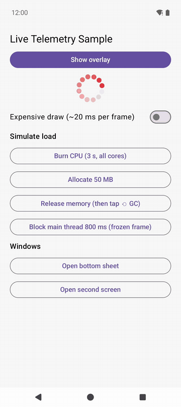
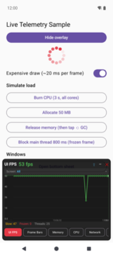
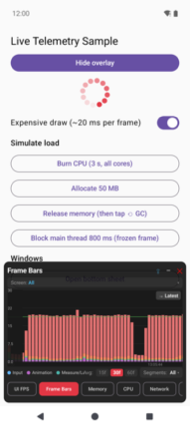
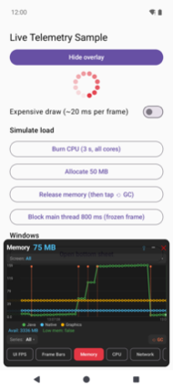
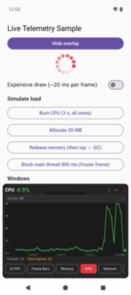
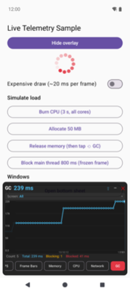
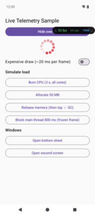
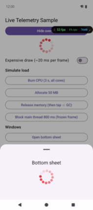
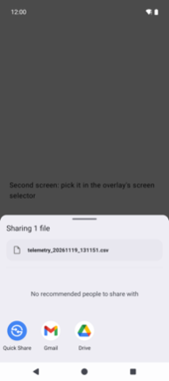

# Live Telemetry

[](https://central.sonatype.com/artifact/com.eternal.kits/live-telemetry)
[](https://github.com/Zomato/live-telemetry/actions/workflows/build.yml)
[](LICENSE)

An in-app, real-time performance overlay for Android. Drop it into any app to watch FPS, frame
timing, memory, CPU, GC and network metrics live while you use the app, and export the session as
a CSV report when something feels slow.

<p align="center">
  
</p>

- **Zero permissions.** The overlay is an application panel window attached to each activity, so
  there is no `SYSTEM_ALERT_WINDOW` and nothing to declare in your manifest.
- **One line to show.** It attaches itself to every activity through
  `Application.ActivityLifecycleCallbacks`. There is no per-screen wiring.
- **Low overhead.** It samples once a second from `/proc` and single Android API calls. Per-frame
  work runs on a background thread, and nothing runs until you show the overlay.
- **No network.** Everything stays in memory until you export it yourself.
- Pure AndroidX + Jetpack Compose, minSdk 24.

## Screenshots

| UI FPS | Frame Bars | Memory | CPU |
|:---:|:---:|:---:|:---:|
|  |  |  |  |
| **GC** | **Collapsed pill** | **Over a bottom sheet** | **Export** |
|  |  |  |  |

## Setup

### 1. Add the dependency

```kotlin
dependencies {
    // Usually only in debug / internal builds, see "Recommended gating" below.
    debugImplementation("com.eternal.kits:live-telemetry:1.0.0")
}
```

The library is on Maven Central, so `mavenCentral()` is all you need.

### 2. Initialize once

```kotlin
class MyApp : Application() {
    override fun onCreate() {
        super.onCreate()
        LiveTelemetryCollector.initialize(this)
    }
}
```

### 3. Show and hide the overlay

```kotlin
// e.g. from a debug drawer, a developer-settings screen or a shake gesture
LiveTelemetryCollector.showTelemetryOverlay(activity)

LiveTelemetryCollector.hideTelemetryOverlay(context)
```

That's it. When you pass an Activity, the overlay appears on it immediately. From then on it
follows every resumed activity and measures each one's frames. Hiding it stops all collection and
clears the session.

### 4. (Optional) Track Compose dialogs and bottom sheets

`Dialog` and `ModalBottomSheet` render in their own window. Without this step the overlay sits
behind them and their frames are not measured. Call `TrackTelemetryWindow` once inside the
content:

```kotlin
ModalBottomSheet(onDismissRequest = { /* … */ }) {
    TrackTelemetryWindow("FiltersSheet")
    SheetContent()
}
```

For a plain `android.app.Dialog`, call `LiveTelemetryCollector.attachWindow(key, dialog.window)`
when it shows and `detachWindow(key, window)` when it is dismissed. Both calls are no-ops while
telemetry is off.

### 5. Export a report

Tap **⇪** in the overlay header. This writes a CSV of every sample plus a readable summary
(average, min and max FPS, CPU peaks, blocking-GC pauses, a per-screen breakdown) and opens the
system share sheet. Reports go to `cacheDir/live_telemetry_reports/`, and the last 5 are kept. They
are shared through the library's own `FileProvider` (`<applicationId>.livetelemetry.fileprovider`),
so it doesn't clash with yours.

## What is collected

| Category | Metrics |
|---|---|
| Rendering | **UI FPS** (perceived, via JankStats, corrected for the display's refresh rate), raw FPS, jank rate, slow frames, frozen frames (>700 ms) |
| Frame breakdown | Per-frame stage durations, like "Profile GPU rendering": input, animation, measure/layout, draw, sync & upload, command issue, swap buffers |
| Memory | Java, native and graphics MB, system available RAM, low-memory flag. A **⟲ GC** button forces a collection so you can watch the graph react |
| GC | Total GC count and time, **blocking** GC count and time (pauses that stop app threads) |
| CPU | Process CPU % (`/proc/self/stat` against wall clock, normalized by core count), live thread count |
| Network | Download and upload KB/s for the app's UID (`TrafficStats`) |
| System | Thermal headroom (API 30+), battery current |

The overlay keeps a rolling buffer of 2,000 per-second samples and 1,000 frame samples. Both
survive activity transitions. A screen selector filters every graph down to a single activity.

Reading the data in code instead of the overlay:

```kotlin
LiveTelemetryCollector.telemetryFlow.collect { sample: LiveTelemetryData -> /* once a second */ }
LiveTelemetryCollector.frameStageFlow.collect { frame: FrameStageSample -> /* per few frames */ }
```

### Notes and limitations

- The CSV export contains the per-second columns: raw FPS, frames, memory, GC, CPU, network and
  system. UI FPS and the frame-stage breakdown are shown only in the overlay for now.
- Since Android 10 the platform rate-limits `ActivityManager.getProcessMemoryInfo()`, so the
  graphics, code and stack figures can update less often than once a second. The Java and native
  heap figures are live.
- Numbers from emulators are not representative. Measure on real devices, ideally release builds.

## Recommended gating

The overlay is a diagnostics tool, and exported reports contain screen (activity) names and
device info. Ship it only in debug or internal builds (`debugImplementation`), or keep it in
release but put the show call behind an internal flag. The Zomato app, for example, enables it
for allow-listed users only.

## How it works

- `LiveTelemetryCollector` samples memory, GC, CPU, network and system state once a second on
  `Dispatchers.Default`. It also listens to `Window.OnFrameMetricsAvailableListener` on a
  dedicated `HandlerThread`, and only for the window currently on top.
- UI FPS uses androidx JankStats with bucket averaging. Non-janky frames count as one refresh
  interval of the actual display, so 90 and 120 Hz devices report correctly.
- The overlay is a Compose UI hosted in a `TYPE_APPLICATION_PANEL` window, attached to the
  activity's or dialog's window token. That's why it needs no permission and disappears with the
  app.

## Sample app

[`sample/`](sample/) has buttons that burn CPU, allocate and release memory, block the main thread,
force expensive draws, open a bottom sheet and switch activities, so you can watch every graph
react:

```bash
./gradlew :sample:installDebug
```

## Building

```bash
./gradlew build                          # library + sample, lint and unit tests
./gradlew :live-telemetry:publishToMavenLocal
```

To develop against a host app without publishing, include this repo as a composite build
(`includeBuild("../live-telemetry")`). The sample app is skipped in that mode unless the host's
`local.properties` sets `compositeBuild.includeSampleApps=true`.

## Contributing

Contributions are welcome. See [CONTRIBUTING.md](CONTRIBUTING.md).

## License

```
Copyright 2026 Zomato Ltd.

Licensed under the Apache License, Version 2.0 (the "License");
you may not use this file except in compliance with the License.
You may obtain a copy of the License at

    https://www.apache.org/licenses/LICENSE-2.0

Unless required by applicable law or agreed to in writing, software
distributed under the License is distributed on an "AS IS" BASIS,
WITHOUT WARRANTIES OR CONDITIONS OF ANY KIND, either express or implied.
See the License for the specific language governing permissions and
limitations under the License.
```
